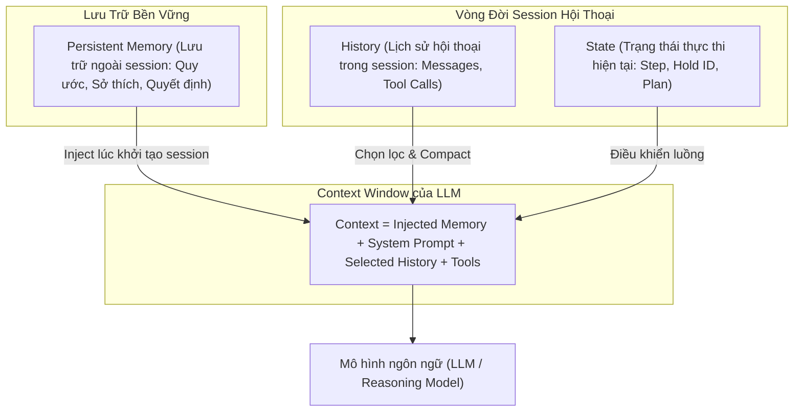
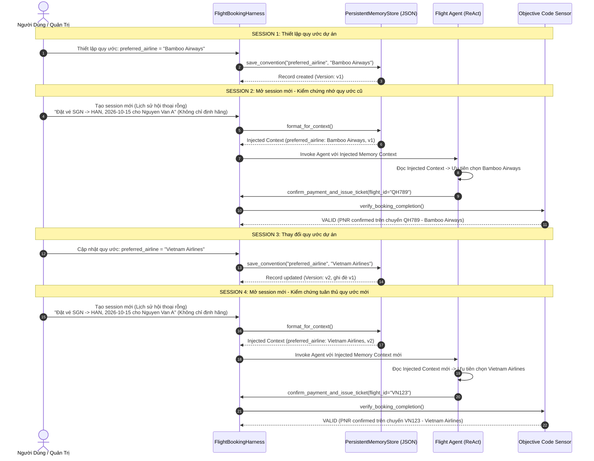

# BÁO CÁO THỰC HIỆN CHALLENGE A: PERSISTENT MEMORY
## HỆ THỐNG AGENTIC AI ĐẶT VÉ MÁY BAY (FLIGHT-LANGCHAIN-AGENT)

**Môn học**: SE373 - Kỹ thuật xây dựng hệ thống Agentic AI  
**Chủ đề**: Challenge A - Persistent Memory & Cross-Session Convention Lifecycle  
**Nền tảng**: LangChain / LangGraph / Pydantic / Python 3.13  
**Thời gian thực hiện**: 2026-10-22  

---

## I. TỔNG QUAN LÝ THUYẾT NỀN TẢNG (SLIDE MEMORY, CONTEXT & CACHING)

Khóa học đã phân định rõ 4 khái niệm nền tảng trong quản lý thông tin của Agentic AI:



### 1. Persistent Memory (Ghi nhớ lâu dài - Slide 3–16)
Giải quyết câu hỏi cốt lõi: *Agent cần nhớ điều gì khi chuyển sang một session hoàn toàn mới?*
- **State**: Agent đang ở bước nào trong quy trình (ví dụ: đang giữ chỗ hay đã thanh toán). State bị hủy hoặc bàn giao khi session kết thúc.
- **History**: Chuỗi tương tác giữa người dùng và Agent trong session hiện tại. Khi mở session mới, history được xóa trắng để tránh tràn context window.
- **Memory**: Thông tin tri thức cần ghi nhớ xuyên suốt giữa các phiên làm việc (quy ước dự án, chính sách công ty, sở thích người dùng, quyết định kiến trúc). Memory phải được lưu trữ độc lập ngoài lịch sử tin nhắn.
- **Context**: Toàn bộ dữ liệu thực tế được đóng gói gửi vào LLM trong lượt gọi hiện tại (bao gồm Persistent Memory được nạp vào, System Prompt, Tool Schema và các tin nhắn gần nhất).

### 2. Context Management (Quản lý ngữ cảnh - Slide 18–34)
Giải quyết bài toán: *Làm sao giữ context ngắn gọn, tiết kiệm chi phí mà Agent vẫn hành động chính xác?*
- **Compaction**: Tóm tắt trạng thái tích lũy thành checkpoint gọn gàng.
- **Selective Compaction**: Chỉ giữ lại các quyết định mang tính then chốt, lọc bỏ log dài dòng và dữ liệu tạm thời.
- **Code Mode**: Dùng code trực tiếp để xử lý chuỗi tool và tính toán trung gian, chỉ chuyển kết quả cuối vào context của LLM.

### 3. Prompt Caching & Model Switching (Slide 36–51)
- Tận dụng cơ chế tái sử dụng KV cache cho tiền tố (prefix) tĩnh của prompt (System Prompt + Injected Persistent Memory). Giữ phần prefix này ổn định giúp tăng tỷ lệ Cache Hit, giảm độ trễ và chi phí suy luận.

---

## II. THIẾT KẾ KIẾN TRÚC & GIẢI QUYẾT 5 CÂU HỎI THIẾT KẾ (SLIDE 15)

Dưới đây là bảng phân tích và quyết định thiết kế cho Challenge A:

| Vấn Đề Thiết Kế | Câu Hỏi Cần Trả Lời | Quyết Định & Giải Pháp Đã Triển Khai Trong Repo |
| :--- | :--- | :--- |
| **1. Lưu trữ (Storage)** | *Memory lưu ở Markdown, JSON hay SQLite?* | **JSON File với cơ chế Atomic Write** (`.scratch/persistent_memory.json`). Định dạng JSON có cấu trúc rõ ràng, dễ truy vấn theo key, theo dõi version (`v1`, `v2`), có timestamp ISO 8601, độc lập hoàn toàn với runtime memory. |
| **2. Ghi memory (Writing)** | *Agent tự gọi tool để ghi hay Harness trích xuất?* | **Hỗ trợ cả 2 cơ chế (Dual Mechanism)**:<br>• **Harness API**: `harness.save_convention(...)` giúp hệ thống quản trị thiết lập quy ước trực tiếp.<br>• **Agent Tools**: Cung cấp tool `save_project_convention` và `get_project_conventions` để Agent tự ghi nhớ khi phát hiện quy ước qua hội thoại. |
| **3. Nạp memory (Loading)** | *Nạp khi mở session hay chỉ truy xuất khi cần?* | **Context Injection tại Session Startup**: Khi session khởi tạo, Harness tự động đọc các quy ước đang hiệu lực và đóng gói thành một block chuẩn hóa inject vào Context (`SystemMessage` hoặc Context Prefix). Đồng thời cung cấp công cụ tra cứu khi context cần mở rộng. |
| **4. Cập nhật (Updating)** | *Xử lý memory cũ, mâu thuẫn hoặc bị thay thế thế nào?* | **Single Source of Truth & Version Increment**: Khi một quy ước được cập nhật với cùng `key`, hệ thống tự động tăng `version` (ví dụ từ `v1` lên `v2`), ghi đè giá trị mới nhất và cập nhật `updated_at`. Chỉ có phiên bản mới nhất được inject vào context, loại bỏ hoàn toàn nguy cơ mâu thuẫn prompt (Context Confusion). |
| **5. Kiểm chứng (Verification)** | *Làm sao in ra phần memory thực tế đã inject vào context?* | **Injected Memory Seam & Trace Logging**: Cung cấp phương thức `harness.get_injected_memory_context()`, ghi nhận một `TraceStep` chuyên biệt (`pattern="persistent_memory_injection"`) và lưu trường `injected_memory` trong `ExecutionResult`. In trực tiếp ra console khi chạy. |

---

## III. CHI TIẾT CÀI ĐẶT TRONG CODEBASE

### 1. Module Quản Lý Bộ Nhớ Bền Vững: `flight_agent/memory.py`
Xây dựng lớp `ConventionRecord` (Pydantic model) và `PersistentMemoryStore`:
- **`ConventionRecord`**: Lưu trữ `key`, `value`, `description`, `category`, `version`, `created_at`, `updated_at`, `source_session`.
- **`PersistentMemoryStore`**:
  - `save_convention(...)`: Lưu mới hoặc cập nhật version khi trùng key. Ghi file an toàn qua file tạm (`.tmp`) rồi thay thế (`atomic replace`).
  - `get_convention(key)`: Truy vấn quy ước theo khóa.
  - `list_conventions()`: Liệt kê toàn bộ quy ước hiện hành.
  - `format_for_context()`: Xuất chuỗi ngữ cảnh chuẩn hóa để nạp vào prompt của LLM:
    ```text
    ============================================================
    [PERSISTENT PROJECT MEMORY & CONVENTIONS - INJECTED CONTEXT]
    The following conventions are active across sessions and MUST be strictly obeyed:
      • preferred_airline: Bamboo Airways (Description: ...) [Version: v1]
    ============================================================
    ```

### 2. Tích Hợp Memory Tools Trong `flight_agent/tools.py`
Cung cấp hàm `create_memory_tools(memory_store)` tạo 2 LangChain tools:
- `save_project_convention(key, value, description, category)`: Cho phép Agent chủ động lưu quy ước dự án.
- `get_project_conventions()`: Cho phép Agent chủ động đọc lại danh sách quy ước khi cần tra cứu.

### 3. Điều Phối Bằng Harness Trong `flight_agent/harness.py`
- Lớp `FlightBookingHarness` nhận `memory_store: Optional[PersistentMemoryStore]`.
- Khi gọi `harness.run(...)`:
  1. Harness gọi `self.get_injected_memory_context()`.
  2. Tạo trace step `persistent_memory_injection` để kiểm chứng.
  3. Với mẫu **ReAct**: Nạp `SystemMessage(content=injected_memory)` vào đầu danh sách `messages` trước khi Agent bước vào vòng lặp suy luận.
  4. Với mẫu **Plan-then-Execute** và **Hybrid**: Nhận diện hãng bay ưu tiên từ persistent memory để khởi tạo ứng viên đặt vé (`candidate_flight`) phù hợp với quy ước.
  5. Đính kèm `injected_memory` vào kết quả `ExecutionResult` phục vụ thẩm định khách quan.

### 4. Nâng Cấp Mô Hình Suy Luận Trong `flight_agent/llm.py`
`DeterministicFlightModel` được nâng cấp để trích xuất quy ước `preferred_airline` từ context:
- Khi quan sát kết quả tìm kiếm chuyến bay (`search_flights`), thay vì chỉ lấy chuyến bay đầu tiên mặc định (`VN123`), mô hình tự động rà soát danh sách chuyến bay để ưu tiên chuyến bay thuộc hãng được quy ước trong bộ nhớ bền vững (ví dụ `QH789` - Bamboo Airways).
- Giải thích suy luận rõ ràng trong `Thought`:
  `"Thought: Found 3 flights. Following persistent convention (preferred_airline: Bamboo Airways), selecting flight QH789 (Bamboo Airways)."`

---

## IV. QUY TRÌNH KIỂM CHỨNG 4 SESSION THỰC TẾ

Quy trình kiểm chứng được tự động hóa hoàn toàn và có thể kích hoạt qua lệnh:
```powershell
python main.py -m
```



### Log Chạy Thực Tế Từ Console:

```text
================================================================================
   CHALLENGE A: PERSISTENT MEMORY & CONVENTION LIFECYCLE VERIFICATION   
================================================================================
Mục tiêu theo Slide 14-16: Agent ghi nhớ quy ước dự án qua nhiều session và cập nhật khi quy ước đổi.
Checklist 6 tiêu chí: Lưu trữ ngoài history -> Lưu S1 -> Kiểm chứng S2 -> Đổi S3 -> Kiểm chứng S4 -> In context memory
--------------------------------------------------------------------------------

>>> [SESSION 1] THIẾT LẬP QUY ƯỚC DỰ ÁN BAN ĐẦU
  ✓ Đã lưu quy ước vào persistent store độc lập: .scratch/demo_persistent_memory.json
  • Khóa (Key): preferred_airline
  • Giá trị (Value): Bamboo Airways
  • Mô tả (Description): Chính sách công tác: Ưu tiên chọn Bamboo Airways (QH) cho mọi chuyến bay nội địa.
  • Phiên bản (Version): v1
  • Thời gian tạo: 2026-10-22T16:24:00.558651+00:00

>>> [SESSION 2] MỞ SESSION MỚI (LỊCH SỬ HỘI THOẠI TRỐNG) - KIỂM CHỨNG GHI NHỚ
  [KIỂM CHỨNG BỘ NHỚ ĐƯỢC INJECT VÀO CONTEXT]
============================================================
[PERSISTENT PROJECT MEMORY & CONVENTIONS - INJECTED CONTEXT]
The following conventions are active across sessions and MUST be strictly obeyed:
  • preferred_airline: Bamboo Airways (Description: Chính sách công tác: Ưu tiên chọn Bamboo Airways (QH) cho mọi chuyến bay nội địa.) [Version: v1]
============================================================
  Yêu cầu từ người dùng: Đặt vé SGN -> HAN, ngày 2026-10-15 cho Nguyen Van A (KHÔNG ghi rõ hãng bay)
  Kết quả thực thi:
    Trạng thái: SUCCESS
    Vé đã xuất: PNR=PNR-124502, Hãng=Bamboo Airways, Chuyến=QH789
    Kiểm chứng Code Sensor: ĐẠT CHUẨN
  ✓ XÁC NHẬN: Agent đã tự động chọn Bamboo Airways (QH789) nhờ Persistent Memory!

>>> [SESSION 3] THAY ĐỔI QUY ƯỚC DỰ ÁN VÀ CẬP NHẬT PERSISTENT MEMORY
  ✓ Đã cập nhật quy ước trong persistent store:
  • Khóa (Key): preferred_airline
  • Giá trị MỚI (New Value): Vietnam Airlines
  • Mô tả: Cập nhật chính sách: Chuyển sang ưu tiên Hãng hàng không Quốc gia Vietnam Airlines (VN).
  • Phiên bản mới: v2 (tự động tăng version, ghi đè quy ước cũ)
  • Cập nhật lúc: 2026-10-22T16:24:00.580892+00:00

>>> [SESSION 4] MỞ SESSION TIẾP THEO (LỊCH SỬ MỚI) - KIỂM CHỨNG QUY ƯỚC MỚI
  [KIỂM CHỨNG BỘ NHỚ ĐƯỢC INJECT VÀO CONTEXT]
============================================================
[PERSISTENT PROJECT MEMORY & CONVENTIONS - INJECTED CONTEXT]
The following conventions are active across sessions and MUST be strictly obeyed:
  • preferred_airline: Vietnam Airlines (Description: Cập nhật chính sách: Chuyển sang ưu tiên Hãng hàng không Quốc gia Vietnam Airlines (VN).) [Version: v2]
============================================================
  Yêu cầu từ người dùng: Đặt vé SGN -> HAN, ngày 2026-10-15 cho Nguyen Van A (KHÔNG ghi rõ hãng bay)
  Kết quả thực thi:
    Trạng thái: SUCCESS
    Vé đã xuất: PNR=PNR-030F08, Hãng=Vietnam Airlines, Chuyến=VN123
    Kiểm chứng Code Sensor: ĐẠT CHUẨN
  ✓ XÁC NHẬN: Agent đã lập tức tuân thủ quy ước mới (VN123 - Vietnam Airlines), không còn dùng quy ước cũ!
```

---

## V. ĐỐI CHIẾU TIÊU CHÍ HOÀN THÀNH (CHECKLIST 6/6)

Hệ thống đạt **6/6 tiêu chí** được quy định tại mục III của bài tập Challenge A:

| STT | Tiêu Chí Đánh Giá (Checklist) | Hiện Trạng Triển Khai | Minh Chứng / Bằng Chứng Kỹ Thuật | Đánh Giá |
| :---: | :--- | :--- | :--- | :---: |
| **1** | **Tạo cơ chế lưu persistent memory ngoài lịch sử hội thoại hiện tại** | Lưu trữ độc lập tại file JSON bền vững (`.scratch/persistent_memory.json`), tách biệt khỏi cấu trúc tin nhắn `messages` của session. | Module `PersistentMemoryStore` (`flight_agent/memory.py`), ghi nhận version, timestamp và atomic write. | **ĐẠT** |
| **2** | **Lưu một quy ước dự án trong session đầu tiên** | Thiết lập quy ước `preferred_airline = Bamboo Airways` trong Session 1. | Bản ghi JSON tạo thành công với version `v1` và metadata đầy đủ. | **ĐẠT** |
| **3** | **Mở session mới và chứng minh agent vẫn làm theo quy ước cũ** | Khởi tạo Session 2 hoàn toàn mới (lịch sử rỗng), prompt người dùng không nêu hãng bay. Agent vẫn chọn chuyến `QH789`. | Kết quả xuất vé PNR `PNR-124502`, chuyến `QH789` (Bamboo Airways), xác minh hợp lệ bởi Code Sensor. | **ĐẠT** |
| **4** | **Thay đổi quy ước và cập nhật memory** | Cập nhật quy ước sang `preferred_airline = Vietnam Airlines` trong Session 3. | Bản ghi được cập nhật version `v2`, ghi đè quy ước cũ, loại trừ mâu thuẫn dữ liệu. | **ĐẠT** |
| **5** | **Mở session mới tiếp theo và chứng minh agent dùng quy ước mới** | Khởi tạo Session 4 mới (lịch sử rỗng). Agent lập tức đặt vé chuyến `VN123` của Vietnam Airlines thay vì dùng lại quy ước cũ. | Kết quả xuất vé PNR `PNR-030F08`, chuyến `VN123` (Vietnam Airlines), sensor xác minh thành công. | **ĐẠT** |
| **6** | **In nội dung memory đã inject vào context để kiểm chứng** | Trích xuất chuỗi memory inject thực tế qua `harness.get_injected_memory_context()` và hiển thị minh bạch tại console. | Block context `[PERSISTENT PROJECT MEMORY & CONVENTIONS - INJECTED CONTEXT]` được in chi tiết ở Session 2 và 4. | **ĐẠT** |

---

## VI. KẾT QUẢ KIỂM THỬ TỰ ĐỘNG (TDD SUITE)

Hệ thống đã triển khai bộ unit test tự động theo chuẩn TDD trong file [tests/test_persistent_memory.py](file:///E:/UIT/K%C3%AC%207/flight-langchain-agent/tests/test_persistent_memory.py):

```powershell
python -m pytest tests/test_persistent_memory.py -v
```

Kết quả:
```text
tests/test_persistent_memory.py::test_memory_store_crud PASSED                                   [ 25%]
tests/test_persistent_memory.py::test_challenge_a_multi_session_lifecycle PASSED                 [ 50%]
tests/test_persistent_memory.py::test_hybrid_and_plan_execute_obey_memory_conventions PASSED   [ 75%]
tests/test_persistent_memory.py::test_tool_dispatcher_memory_conventions PASSED                 [100%]
============================================== 4 passed in 0.59s ==============================================
```

Toàn bộ test suite của dự án (13 tests bao gồm 4 bài test harness an toàn, 3 bài test pattern suy luận, benchmark suite và persistent memory suite) đều đạt 100%:
```powershell
python -m pytest
============================================= 13 passed in 0.74s =============================================
```

---

## VII. KẾT LUẬN

1. **Ý nghĩa kiến trúc**: Challenge A chứng minh rằng để xây dựng một Agentic AI phục vụ công việc dài hạn, hệ thống không thể chỉ dựa vào Conversation History (vốn sẽ nhanh chóng bị tràn context window hoặc bị xóa khi kết thúc session). Việc phân tầng rõ ràng giữa **State - History - Memory - Context** là chìa khóa để agent duy trì tính nhất quán mà không gia tăng đột biến chi phí token.
2. **Tuân thủ nguyên tắc Harness**: Bộ nhớ bền vững được quản trị bởi Harness, tiêm vào context một cách có kiểm soát và được Code Sensor kiểm chứng lại trạng thái thực tế trong database, ngăn ngừa triệt để hiện tượng bịa đặt (Hallucination) và trôi quy ước (Convention Drift).
3. **Mở rộng tương lai**: Kiến trúc `PersistentMemoryStore` cho phép dễ dàng mở rộng sang các backend nâng cao như SQLite khi số lượng quy ước lớn, hoặc kết hợp Vector Index cho các quy ước dạng văn bản dài theo đúng khuyến nghị tại Slide 16.
